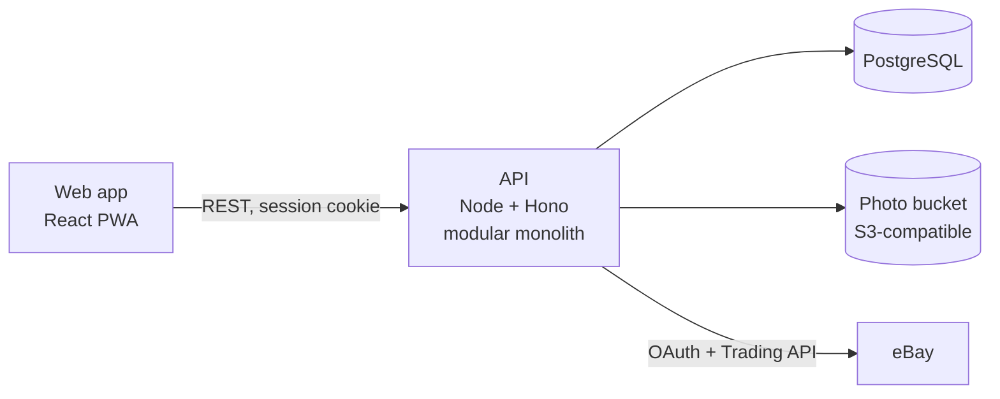

# Inventory for unique items, with eBay

A private web app for a seller whose every item exists exactly once: vintage cameras, watches, one-off pieces.

## Why it exists

A one-of-a-kind item can be sold only once. The seller has to know, at any moment, what is in stock, what is listed on eBay and what is already sold, or risks selling the same item twice and cancelling an order. eBay's own tools cover listings, not the stock behind them, and a spreadsheet goes stale the moment a sale happens.

This app is the single record of that stock:

- One entry per physical item, with photos, price, condition and status (available, reserved, sold, archived).
- Every status change is recorded with its cause, so "why is this marked sold?" always has an answer.
- Existing eBay listings are imported as items in one tap; nothing is typed twice.
- It runs on the seller's phone as an installable app, because that is where the items and the camera are.

## Requirements

| | |
|---|---|
| Users | One owner. Optionally one restricted demo account |
| Scale | One seller, thousands of items, a handful of requests per minute |
| Correctness | An item has one status; changes are audited; an eBay listing maps to at most one item |
| Security | Private data, eBay credentials held on the server only |
| Cost | One small container, one database, one bucket |
| Out of scope (owner's decision) | Live updates, eBay webhooks, background jobs. Data is loaded on open and on manual refresh |

## Architecture



One container serves both the API and the built web app. The browser never talks to eBay or to the bucket; everything goes through the API.

| Layer | Tech |
|---|---|
| Frontend | React 19, TypeScript, Vite, Tailwind, shadcn/ui, TanStack Query, installable PWA |
| Backend | Node 24, TypeScript, Hono with zod-openapi, Prisma 7 |
| Data | PostgreSQL 17, S3-compatible object storage |
| Hosting | Railway: one service, managed Postgres, one bucket, EU region |

Backend modules: `authentication`, `products`, `images`, `sales`, `dashboard`, `ebay`, `demo`. Each owns its routes, service and validation; they share one database and one process.

## Data model

- **Product**: one physical item. Owned by an account.
- **ProductImage**: photo metadata; the files live in the bucket.
- **ProductStatusChange**: append-only history of status changes with their source (manual, import, eBay order).
- **EbayListing**: link between an item and an eBay listing. The eBay item ID is unique.
- **Sale**: an eBay order line for an item. Blocks deletion of the item.
- **EbayAccount**: the connected seller account, tokens encrypted.
- **AdminUser / AdminSession**: accounts and server-side sessions.

## Design decisions

| Decision | Why | Cost |
|---|---|---|
| Modular monolith, one container | One user and low traffic; nothing to scale independently | Scaling out later means moving rate limiting out of process memory |
| PostgreSQL is the source of truth, eBay is read | The app must work and stay consistent when eBay is slow or down | Data from eBay is as fresh as the last refresh |
| No webhooks, no scheduler | Fewer moving parts and no public endpoints to secure | No instant sale detection |
| Server-side sessions, not JWT | Logout and password change revoke access immediately | One indexed lookup per request |
| Deny-by-default API guard | A new route cannot be public by accident | Public routes must be listed explicitly |
| Every query filtered by owner | The demo account shares the deployment without seeing real data | An owner ID on every service call |
| Photos resized in the browser, stored privately | Small uploads from a phone; no public file URLs | The server checks the image header, not the pixels |
| eBay pictures referenced, not copied | No storage or copyright handling for imported listings | Pictures disappear if eBay removes them |
| Import is idempotent | "Add all" is safe to repeat or run twice at once | Relies on the unique eBay item ID |
| HTTP layer uses Web APIs only | Can move to an edge runtime without rewriting modules | Node-specific code is confined to one entry file |

## Security

- Passwords hashed with Argon2id. Session token in an HttpOnly, SameSite cookie; only its hash is stored.
- CSRF protection by required custom header and origin check. Login is rate limited.
- eBay access through OAuth 2.0; tokens encrypted with AES-256-GCM and never sent to the browser.
- Another account's item answers "not found", so IDs cannot be probed.
- The demo account works on sample data, is limited to 5 changes per sign-in, and gets a simulated eBay in place of the real one.

## Status

| | |
|---|---|
| Built and live | Inventory, photos, status history, login, installable app, eBay connection, import of active listings, demo account |
| Next | Detecting eBay sales and marking items sold, on open and manual refresh |
| Later | Creating and ending eBay listings from the app |

330 automated tests: 257 backend (unit, and integration against a real PostgreSQL), 73 frontend. eBay is simulated in tests; the connection and the listing import have also been run against eBay itself.

## Run it locally

Needs Node 22.9 or newer and Docker.

```bash
cp backend/.env.example backend/.env
npm install
npm run db:up                    # PostgreSQL in Docker
npm run db:deploy -w backend     # create the tables
npm run db:seed -w backend       # sample items and the admin login from backend/.env
npm run dev:backend              # terminal 1: API on http://localhost:3000
npm run dev:frontend             # terminal 2: app on http://localhost:5173
```

Setup details, eBay keys, deployment and troubleshooting: [docs/development.md](docs/development.md). Design notes and open questions: [docs/architecture.md](docs/architecture.md).
